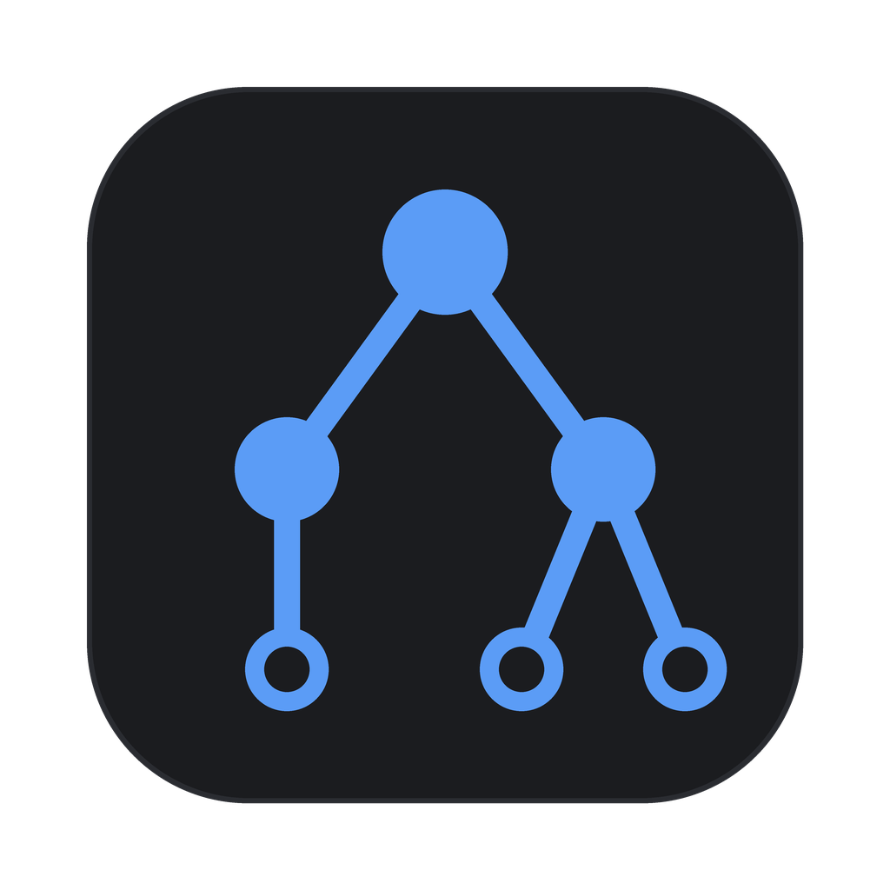

  

<h1 align="center">Tiptap Studio</h1>

  A desktop app to inspect, edit, diff and validate Tiptap / ProseMirror JSON documents. 
  For macOS, Windows and Linux, built on a fast Rust parser.

  <a href="https://github.com/alexvcasillas/tiptap-studio/releases"><b>Download</b></a> ·
  <a href="https://tiptap-studio.alexvcasillas.dev/docs/studio"><b>Documentation</b></a> ·
  <a href="https://tiptap-studio.alexvcasillas.dev">Website</a>

## What it does

- **Inspect** a document as a node tree, a rendered preview, its JSON source and an
  inspector, all on the same selection. Unknown node types render and stay editable.
- **Edit structurally**: insert, wrap, lift, split, join and move nodes; edit attributes,
  marks, text and raw JSON. Every edit is one undo step.
- **Diff and merge** two documents: take or dismiss each change, apply whole subtrees, and
  save the merged result.
- **Validate** against a schema or the bundled StarterKit one, and step through every
  problem.
- **Find** nodes with a small query language: `type == heading && attrs.level > 1`.
- **Browse** a Tiptap Document Server, read-only, with tokens kept in your keychain.

Start with the [install guide](https://tiptap-studio.alexvcasillas.dev/docs/studio) and the [tour](https://tiptap-studio.alexvcasillas.dev/docs/studio/tour).

## The engine

Everything the app does to a document goes through crates you can use directly:

| Package | What it is | Docs |
| --- | --- | --- |
| [`tiptap-rusty-parser`](https://crates.io/crates/tiptap-rusty-parser) | Parse, query, edit, diff and validate `JSONContent` in Rust | [Guide](https://tiptap-studio.alexvcasillas.dev/docs/parser) · [API](https://docs.rs/tiptap-rusty-parser) |
| [`tiptap-rusty-markdown`](https://crates.io/crates/tiptap-rusty-markdown) | Markdown to `JSONContent` and back (CommonMark and GFM) | [Guide](https://tiptap-studio.alexvcasillas.dev/docs/markdown) · [API](https://docs.rs/tiptap-rusty-markdown) |
| [`@tiptap-studio/rusty-parser`](https://www.npmjs.com/package/@tiptap-studio/rusty-parser) | The parser for JavaScript, compiled to WebAssembly | [Guide](https://tiptap-studio.alexvcasillas.dev/docs/javascript) |

## Repository

| Path | Contents |
| --- | --- |
| [`studio/`](studio/) | The desktop app (GPUI) |
| [`parser/`](parser/) | `tiptap-rusty-parser` |
| [`markdown/`](markdown/) | `tiptap-rusty-markdown` |
| [`bindings/wasm/`](bindings/wasm/) | The WebAssembly bindings |
| [`docs/`](docs/) | The documentation site (Fumadocs) |
| [`docs-check/`](docs-check/) | Compiles every Rust example on the docs site in CI |

## License

MIT
